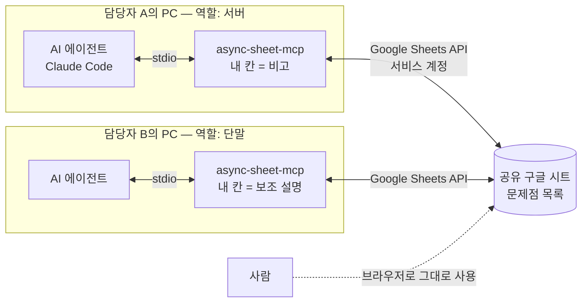
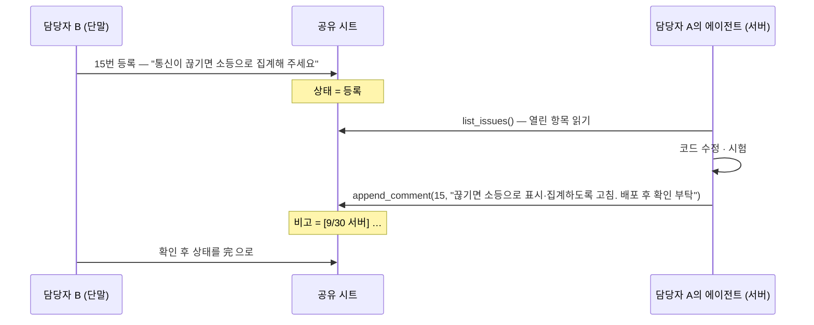

# async-sheet-mcp

**공유 구글 시트 한 장을, 떨어져 일하는 소규모 팀과 그들의 AI 에이전트가 함께 쓰는 "비동기 인계 창구"로 만드는 MCP 서버.**

> An MCP server that turns a shared Google Sheet issue list into an asynchronous handoff channel for small,
> remote teams — each teammate's AI agent reads open items, does the work, and writes a dated reply
> **only into its own column**.

  

---

## 목차

1. [어떤 문제를 푸는가](#1-어떤-문제를-푸는가)
2. [해결 방식](#2-해결-방식)
3. [기능](#3-기능)
4. [동작 구조](#4-동작-구조)
5. [시트 규약](#5-시트-규약)
6. [설치와 등록](#6-설치와-등록)
7. [설정값](#7-설정값)
8. [사용 예](#8-사용-예)
9. [설계에서 신경 쓴 점](#9-설계에서-신경-쓴-점)
10. [한계](#10-한계)
11. [개발](#11-개발)

---

## 1. 어떤 문제를 푸는가

하드웨어(펌웨어) 개발자 1명과 서버 개발자 1명이 **서로 다른 장소·다른 시간**에 일하는 IoT 프로젝트에서 출발했습니다.
두 사람은 실시간으로 대화하기 어려워, **구글 시트의 문제점 목록**에 요청을 올리고 답을 적는 방식으로 협업했습니다.

두 사람 모두 AI 코딩 에이전트(Claude Code)를 쓰기 시작하자 병목이 드러났습니다.

| 겪은 일 | 왜 문제였나 |
|---|---|
| 시트를 엑셀로 내려받아 AI 에게 붙여넣기 | 매번 손이 가고, 붙여넣은 순간부터 낡은 사본이 됨 |
| 작업이 끝나면 회신 문구를 사람이 시트에 옮겨 적기 | 빠뜨리거나 다른 칸에 적는 실수, "어디까지 됐는지" 서로 모름 |
| 회신이 한 칸에서 덮어써짐 | 누가 언제 무슨 말을 했는지 이력이 사라짐 |
| 이슈 트래커(Jira 등) 도입 검토 | 두 명에게는 과하고, 상대는 이미 시트에 익숙함 |

**필요했던 것은 새 도구가 아니라, 이미 쓰는 시트를 AI 가 직접 읽고 규칙대로 답하게 하는 얇은 연결고리**였습니다.

## 2. 해결 방식

- 각자의 PC 에서 이 MCP 서버를 띄우고, AI 에이전트가 시트를 **직접 읽고 씁니다.**
- 같은 코드를 쓰되 **역할(환경 변수)** 만 다르게 줍니다. 서버 담당의 에이전트는 `비고` 칸에, 단말 담당의 에이전트는 `보조 설명` 칸에만 씁니다.
- 회신은 지우지 않고 **`[9/30 서버] …` 처럼 날짜·역할 머리표를 붙여 아래에 쌓습니다.** 칸 하나가 그대로 대화 이력이 됩니다.
- 사람이 하는 말은 이 정도로 줄어듭니다.

```text
"시트 열린 항목 읽고 작업 시작해"      → 읽기 → 코드 수정 → 확인 → 회신 초안 → 시트에 기록
"13번 지금 어디까지 됐어?"             → 그 행의 이력을 읽고 요약
"단말 쪽에 물어볼 것 3개 시트에 올려"  → 새 행 3개 등록
```

## 3. 기능

| 도구 | 하는 일 | 쓰기 |
|---|---|:---:|
| `list_issues(status="open")` | 끝나지 않은 항목 목록. `"all"` 이나 특정 상태값(`"재등록"`)으로도 조회. 긴 칸은 잘라서 토큰 절약 | |
| `get_issue(no)` | 한 건 전체 + **연결탭**(상세 설명 탭)의 내용까지 한 번에 | |
| `read_tab(name)` / `list_tabs()` | 임의 탭을 텍스트로 / 탭 목록 | |
| `append_comment(no, text)` | 내 칸 끝에 `[M/D 역할] text` 를 새 줄로 덧붙임. 칸 줄바꿈과 행 높이까지 맞춤 | ✔ |
| `set_status(no, status)` | 상태 칸 변경(등록 → 확인중 → 完 등) | ✔ |
| `add_issue(mode, problem, …)` | 맨 아래 새 행(다음 번호·오늘 날짜 자동) — 문제 등록, 상대에게 질문 | ✔ |

- **역할 분리**: 내 칸과 상대 칸을 설정으로 나눠, 에이전트가 상대의 글을 건드리지 않습니다.
- **에이전트 안내문 내장**: 서버가 접속한 에이전트에게 "열린 항목부터 본다 · 쓰기 전에 문구를 보여 준다 · 비밀값은 적지 않는다 · 상대 칸은 쓰지 않는다"를 직접 알려 줍니다(MCP `instructions`). 프롬프트를 매번 쓰지 않아도 규칙이 따라옵니다.
- **읽기 전용 점검**: `async-sheet-mcp --check` 로 시트에 손대지 않고 연결·권한을 확인합니다.

## 4. 동작 구조



- 표준 입출력(stdio)으로만 통신합니다. **포트를 열지 않고, 별도 서버·DB 가 없습니다.** 시트가 곧 저장소입니다.
- 사람은 지금까지처럼 브라우저에서 시트를 봅니다. 에이전트가 쓴 회신도 같은 칸에 보입니다.



## 5. 시트 규약

표 한 장이면 됩니다. **첫 칸이 `No.` 인 행을 헤더로 인식**하므로 표 위에 제목·범례 행이 있어도, 열 순서가 달라도 동작합니다.

| No. | 발생 일자 | 모델 | 모드 | 문제점 | 연결탭 | 보조 설명 | 상태 | 비고 |
|---|---|---|---|---|---|---|---|---|
| 15 | 2026-09-30 | 서버 | 상태 | [문제] 통신이 끊겨도 점등으로 집계됨<br>[대책] 끊기면 소등으로 | | | 등록 | |
| 16 | 2026-09-30 | 서버 | 웹 | [문제] 폰에서 접속하면 401 | 16번 | [10/1 단말] 로그인 화면 확인 | 完 | [9/30 서버] 로그인 화면으로 바꿈. 배포 후 확인 부탁 |

| 열 | 쓰임 |
|---|---|
| `No.` | 행 번호(필수, 헤더 인식 기준) |
| `상태` | `list_issues` 필터, `set_status` 대상 |
| `연결탭` | 긴 설명·그림을 따로 둔 탭 이름. `get_issue` 가 함께 읽음 |
| 내 칸 / 상대 칸 | 기본 `비고` / `보조 설명`. 설정으로 바꿈 |
| `발생 일자` `모델` `모드` `문제점` | `add_issue` 가 채우는 칸(없는 열은 건너뜀) |

열 이름은 공백·줄바꿈을 무시하고 비교합니다(`발생⏎일자` = `발생일자`).

## 6. 설치와 등록

**준비 (한 번)**
1. Google Cloud 에서 서비스 계정을 만들고 JSON 키를 받습니다. 프로젝트에 **Google Sheets API** 를 켭니다.
2. 시트 **[공유]** 에 서비스 계정 이메일을 **편집자**로 추가합니다.
3. 키 파일은 **저장소 밖**에 둡니다(예: `C:\keys\`).

**설치**
```bash
git clone https://github.com/masterjms/async-sheet-mcp.git
cd async-sheet-mcp
python -m venv .venv
.venv/Scripts/python -m pip install -e .        # macOS/Linux: .venv/bin/python
```

**연결 점검 (읽기만)**
```powershell
$env:GOOGLE_APPLICATION_CREDENTIALS="C:\keys\my-service-account.json"
$env:SHEET_ID="<스프레드시트 ID>"; $env:SHEET_TAB="문제점"; $env:PYTHONUTF8="1"
.venv\Scripts\async-sheet-mcp --check
```

**Claude Code 에 등록** — 역할만 바꿔 각자 등록합니다.
```powershell
# 담당자 A (서버)
claude mcp add issue-sheet --scope user `
  -e PYTHONUTF8=1 `
  -e "GOOGLE_APPLICATION_CREDENTIALS=C:\keys\my-service-account.json" `
  -e SHEET_ID=<스프레드시트 ID> -e SHEET_TAB=문제점 `
  -e "SHEET_PROJECT=가로등 관제" -e SHEET_ROLE=서버 `
  -e SHEET_MY_COLUMN=비고 -e "SHEET_PEER_COLUMN=보조 설명" `
  -- "C:\path\to\async-sheet-mcp\.venv\Scripts\async-sheet-mcp.exe"

# 담당자 B (단말) — 역할과 칸만 반대로
#   -e SHEET_ROLE=단말 -e "SHEET_MY_COLUMN=보조 설명" -e SHEET_PEER_COLUMN=비고
```
새 세션을 열면 도구가 보입니다. 시트가 여러 개면 **이름만 바꿔 여러 번 등록**하면 됩니다(같은 코드, 다른 환경 변수).

## 7. 설정값

| 환경 변수 | 기본 | 설명 |
|---|---|---|
| `GOOGLE_APPLICATION_CREDENTIALS` | (필수) | 서비스 계정 JSON 키 경로 |
| `SHEET_ID` | (필수) | 스프레드시트 ID (`/d/` 와 `/edit` 사이) |
| `SHEET_TAB` | `문제점` | 문제점 표가 있는 탭 |
| `SHEET_PROJECT` | | 프로젝트 이름. 에이전트 안내문에 들어가 여러 시트를 구분 |
| `SHEET_ROLE` | `서버` | 이 PC 의 역할 = 회신 머리표 `[M/D 역할]` |
| `SHEET_MY_COLUMN` | `비고` | 내가 회신을 적는 열 |
| `SHEET_PEER_COLUMN` | `보조 설명` | 상대의 열 — 쓰지 않음 |
| `SHEET_DONE` | `完,완료,사양` | 끝난 것으로 보는 상태값 |
| `SHEET_UTC_OFFSET` | `9` | 날짜 머리표의 시간대 |

## 8. 사용 예

```text
사용자  시트에 새로 올라온 것 있어?
에이전트 (list_issues) 열린 항목 4건입니다.
         15 [등록] 통신이 끊겨도 점등으로 집계됨
         16 [등록] 폰에서 접속하면 401
         13 [재등록] 지도 핀이 작아 잘 안 보임 …

사용자  15번이랑 16번 처리해 줘.
에이전트 (get_issue ×2 → 코드 수정 → 시험)
         고쳤습니다. 시트에는 이렇게 적겠습니다.
         15: 끊기면 마지막 보고와 관계없이 소등으로 표시·집계합니다.
         16: 브라우저 기본 로그인 창 대신 로그인 화면으로 바꿨습니다. 배포 후 확인 부탁드립니다.

사용자  응 적어.
에이전트 (append_comment ×2) 비고 칸에 [9/30 서버] 로 기록했습니다.
```

## 9. 설계에서 신경 쓴 점

- **기존 습관을 바꾸지 않는다** — 새 트래커를 들이지 않고 이미 쓰던 시트를 그대로 씁니다. AI 를 쓰지 않는 사람도 같은 시트로 계속 일할 수 있습니다.
- **칸 소유권** — 에이전트는 자기 칸에만 씁니다. 두 에이전트가 같은 칸을 고쳐 서로의 글을 지우는 일을 구조적으로 막습니다.
- **덧붙이기만 한다** — 회신은 기존 글 아래에 날짜·역할과 함께 쌓입니다. 별도 로그 없이 칸 하나가 이력입니다.
- **쓰기는 눈에 띄게** — 쓰기 도구는 설명에 `[쓰기]` 를 달고, 서버 안내문으로 "문구를 먼저 보여 줄 것"을 요구합니다. 공유 문서를 조용히 바꾸지 않습니다.
- **비밀값은 코드 밖** — 키·시트 ID 는 환경 변수로만 받습니다. 오류 메시지에도 키 경로를 싣지 않습니다. `.gitignore` 가 `*.json`·`.env` 를 막습니다.
- **시트 모양에 덜 민감하게** — 헤더를 위치가 아니라 `No.` 로 찾고, 열을 이름으로 찾습니다. 시트가 `12.0` 으로 돌려주는 번호도 `12` 로 맞춥니다.
- **사람이 읽기 좋게 쓴다** — API 로 쓴 긴 글이 옆 칸으로 넘치지 않게 줄바꿈을 켜고, 글자 폭(한글 13px·영문 7px)으로 필요한 행 높이를 계산해 키웁니다. 그림이 든 행을 위해 줄이지는 않습니다.
- **토큰을 아낀다** — 목록은 칸을 300자에서 자르고, 자세한 내용은 한 건만 `get_issue` 로 읽습니다.
- **작게 유지한다** — 파일 하나, 의존성 3개(`mcp` · `gspread` · `google-auth`), 상태 없음. 읽고 고치기 쉬운 크기가 목표입니다.

## 10. 한계

- 시트 속 **이미지**는 읽지 못합니다(Sheets API 제약). 필요하면 `…/export?format=xlsx` 로 받아서 봅니다.
- **알림이 없습니다.** 상대가 적었는지는 "시트 확인해"라고 해야 읽습니다. 실시간 협업 도구가 아니라 **비동기 인계**용입니다.
- 사람이 같은 칸을 편집하는 순간과 겹치면 나중에 쓴 쪽이 남습니다. 쓰기는 칸 하나 단위라 범위는 좁습니다.
- 열 이름 `No.` `상태` `연결탭` 등은 한국어 기준입니다. 내 칸·상대 칸·탭·완료 상태값은 설정으로 바꿀 수 있습니다.
- 2~5명 규모를 생각하고 만들었습니다. 권한·워크플로가 필요한 팀이라면 정식 이슈 트래커가 맞습니다.

## 11. 개발

```bash
.venv/Scripts/python -m pip install -e ".[dev]"
.venv/Scripts/python -m pytest -q        # 시트 접속 없이 도는 순수 함수 시험
.venv/Scripts/python -m ruff check src tests
```

```
src/async_sheet_mcp/server.py   MCP 서버 (도구 7개)
tests/test_helpers.py           헤더 찾기 · 번호 정규화 · 회신 형식 · 행 높이 계산
.env.example                    설정 예시 (실제 값은 커밋하지 않음)
```

MIT License
